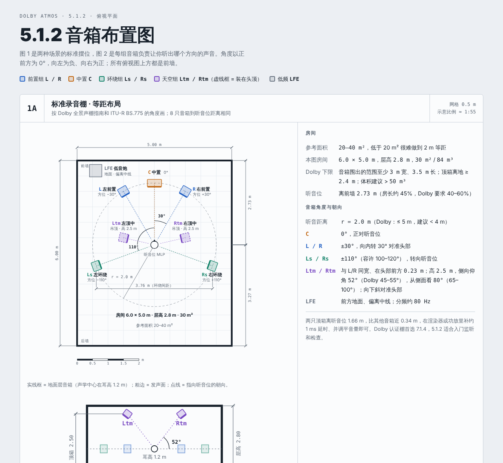

# 5.1.2 音箱布置图 · Dolby Atmos 5.1.2 Speaker Layout

杜比全景声 5.1.2 系统的标准摆位图：标准录音棚和桌面近场两种场景的平面图与剖面图（尺寸、角度、朝向），8 只音箱的标准名称，以及每组音箱负责让人分辨哪个方向的声音。

**在线预览：https://cningpica.github.io/dolby-512-speaker-layout/**



## 内容

| 图 | 内容 |
|---|---|
| 图 1A | 标准录音棚：6.0 × 5.0 m、层高 2.8 m（参考面积 20–40 m²），8 只音箱 2 m 等距，附 A–A 剖面 |
| 图 1B | 桌面近场：桌面 1.6 × 0.8 m，整套占地约 2.4 × 2.0 m，1 m 等距，附剖面 |
| 名称表 | L / R / C / LFE / Ls / Rs / Ltm / Rtm 的英文标准名、中文名、两种场景下的位置 |
| 图 2 | 每组音箱负责的方向范围：俯视水平分区 + 正视仰角分区 |

页面自动跟随系统的浅色 / 深色模式。

## 工程结构

```
index.html             构建出的完整页面（GitHub Pages 直接发布它）
build.py               一键构建脚本
src/gen.py             几何计算：音箱坐标、角度、尺寸标注，生成全部 SVG 并填进模板
src/template.html      页面模板：样式、文案、参数表、名称表
src/skeleton-head.html 页面外壳（doctype、viewport、基础样式）
docs/                  README 用的预览图
```

## 修改与重新构建

需要 Python 3，不依赖第三方库。

```bash
python3 build.py      # 生成 index.html（中间文件在 build/，不进版本库）
```

常改的几何参数都在 `src/gen.py` 顶部各段：

| 参数 | 含义 | 当前值 |
|---|---|---|
| `ROOM_W, ROOM_L, CEIL` | 录音棚宽、长、层高（m） | 5.0, 6.0, 2.8 |
| `DF` | 听音位到前墙的距离（m） | 2.73 |
| `r`（图 1A 段） | 录音棚听音距离（m） | 2.0 |
| `Ltm / Rtm`、`TOPZ` | 录音棚顶箱平面位置、高度（m） | (±1.0, 0.23)，2.5 |
| `r`（图 1B 段） | 桌面听音距离（m） | 1.0 |
| `FW, FD` | 桌面方案建议占地宽、深（m） | 2.4, 2.0 |
| `DESK` | 桌面范围（m） | 1.6 × 0.8 |
| `TOPZ_D`、`CEIL_D` | 桌面方案顶箱高度、最低层高（m） | 1.9, 2.4 |

改了尺寸后，`src/template.html` 里右侧参数栏和名称表的文字数字也要一起改。

## 分支与版本管理

| 名称 | 类型 | 内容 |
|---|---|---|
| `main` | 分支 | 最新版本，GitHub Pages 从这里发布 |
| `release/v1` | 分支 | v1 这条线的维护分支 |
| `v1.0.0` | 标签 | 首个版本的快照 |

约定：小修改打 `v1.1.0`、`v1.1.1`……；大改版（比如换版式、加 7.1.4）出 `v2.0.0` 并建 `release/v2` 分支。每次变化写进 [CHANGELOG.md](CHANGELOG.md)。

## 数据来源

- [Dolby Atmos Home Entertainment Studio Certification Guide](https://www.lafontaudio.com/documents/Atmos_authoring_studio.pdf)
- [Focal：Guidelines for Dolby Atmos installation](https://media.focal-naim.com/focal/file_manager_files/autres-pages/guidelines-dolby-atmos/dolbyatmos-guidelines-installation.pdf)
- [Sound On Sound：Setting Up An Atmos Mixing Room](https://www.soundonsound.com/techniques/setting-atmos-mixing-room)
- [EBU Technical Review 274](https://tech.ebu.ch/files/live/sites/tech/files/shared/techreview/trev_274-hoeg.pdf)
- [阿强家庭影院网：5.1.2 到 7.2.4 全攻略](https://www.av269.com/2026/0823/4464.shtml)
- [Denon AVR-X2800H 说明书：音箱摆位](https://manuals.denon.com/avrx2800h/na/en/DRDZSYpvilxnds.php)
